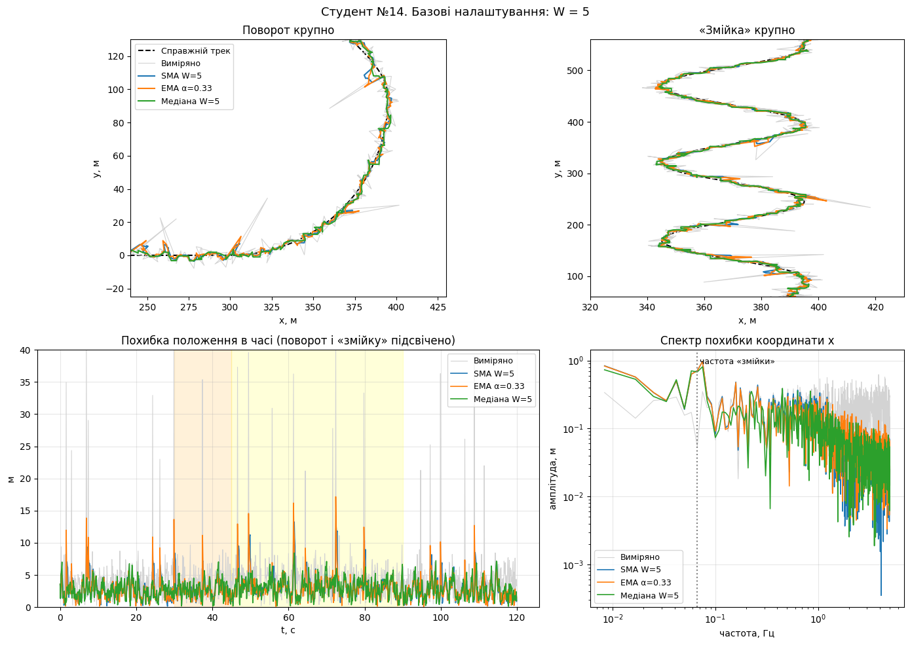
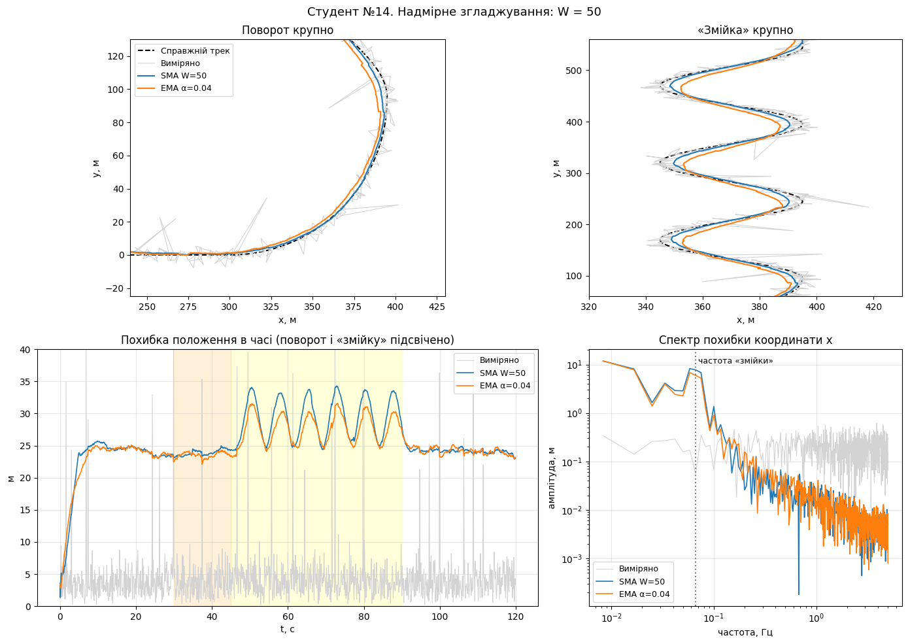
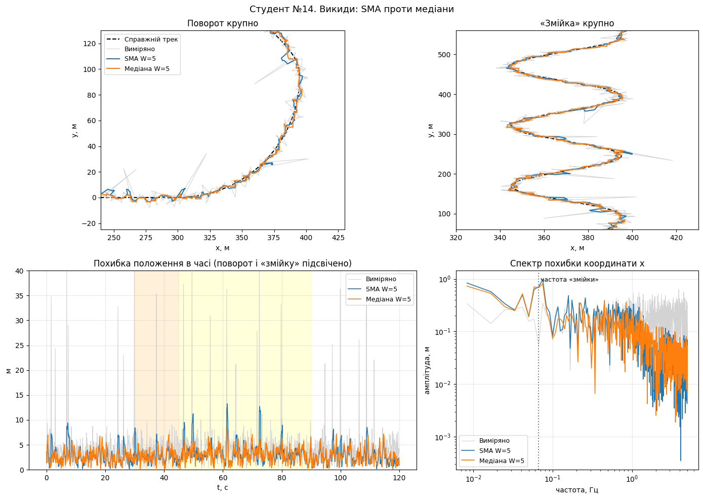
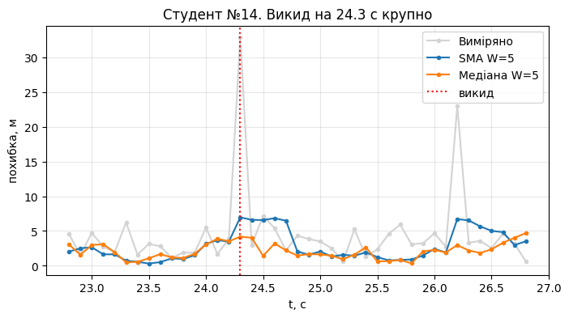
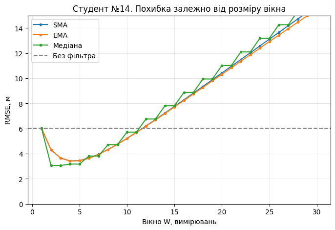
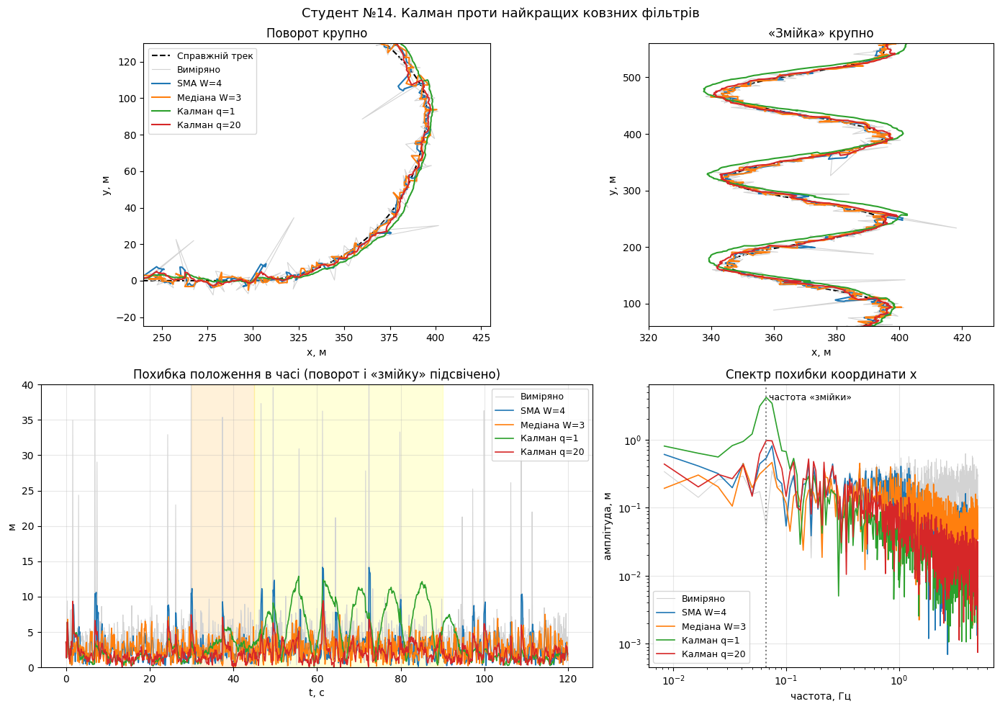
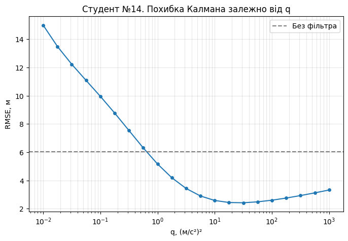
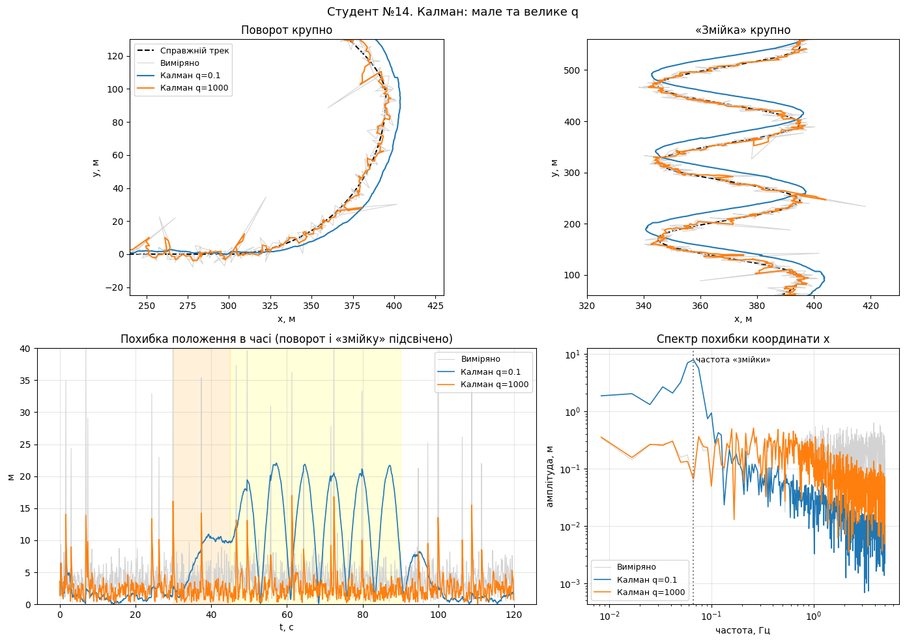
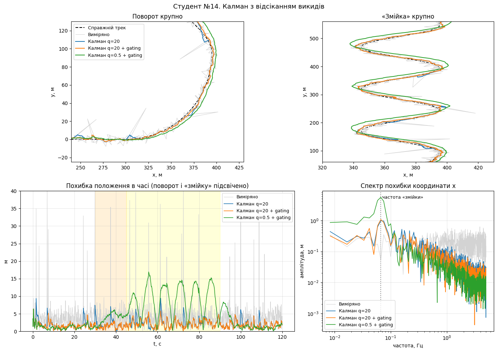
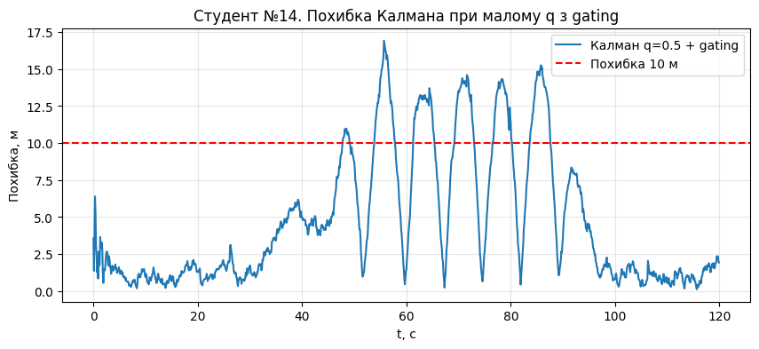

# Лабораторна робота №5

**Тема:** Придушення шумів у координатних даних: ковзні фільтри, спектр похибки і фільтр Калмана

**Варіант:** студент №14

## Мета роботи

Навчитися фільтрувати шумні координати, порівняти прості ковзні фільтри з фільтром Калмана та перевірити, як на точність впливають розмір вікна, параметр `q` і відсікання викидів.

## Початкові дані

Для варіанта №14 згенеровано 1200 вимірювань з інтервалом 0.1 с. Загальна тривалість становить 120 с. У даних є 22 викиди (приблизно 1.83% усіх вимірювань).

Початкова RMSE без фільтрації становить **6.02 м**.

У першій частині реалізовано три потокові фільтри:

- **SMA**: середнє останніх `W` вимірювань. Для оновлення використано кільцевий буфер і поточну суму, тому обробка одного вимірювання має складність `O(1)`.
- **EMA**: експоненційне середнє, де нове значення залежить від поточного вимірювання і попереднього результату.
- **Median**: медіана останніх `W` вимірювань.

Усі перевірки для SMA, EMA та Median пройдено, включно з перевіркою часу роботи SMA.

## Частина 1. Ковзні фільтри

### Експеримент 1. Базові налаштування

Порівняли фільтри з невеликим вікном `W = 5`. Для EMA використали `α = 2 / (W + 1) ≈ 0.33`.

| Фільтр | RMSE, м |
|---|---:|
| Без фільтра | 6.02 |
| SMA W=5 | 3.45 |
| EMA α=0.33 | 3.44 |
| Медіана W=5 | **3.17** |

Усі три фільтри зменшили похибку. Найкраще спрацювала медіана, оскільки вона добре прибирає окремі великі викиди. SMA та EMA дали майже однакову RMSE. При `α = 2 / (W + 1)` їхній рівень згладжування приблизно однаковий, хоча самі алгоритми працюють по-різному.

### Експеримент 2. Надмірне згладжування

Збільшили вікно до `W = 50` і порівняли SMA та EMA.

| Фільтр | RMSE, м |
|---|---:|
| Без фільтра | 6.02 |
| SMA W=50 | 26.38 |
| EMA α≈0.04 | 25.50 |

Координати стали плавнішими, але загальна похибка сильно зросла. Фільтри почали відставати від справжнього положення об'єкта, особливо під час поворотів і руху «змійкою».

Для швидкості 10 м/с і частоти вимірювань 10 Гц очікуване відставання SMA на прямій:

`Δ = v × (W - 1) / (2 × f) = 10 × 49 / 20 = 24.5 м`.

На графіку похибка на прямих ділянках справді тримається приблизно на рівні 24–25 м. У спектрі високочастотний шум став меншим, але низькочастотна похибка зросла через затримку та спотворення руху. Тому сильніше згладжування не завжди означає кращу точність.

### Експеримент 3. Викиди

Порівняли, як SMA та медіана з вікном `W = 5` реагують на різкі викиди.

| Дані | Найбільша похибка, м | Час, с |
|---|---:|---:|
| Без фільтра | 42.9 | 72.4 |
| SMA W=5 | 13.2 | 61.5 |
| Медіана W=5 | **8.4** | 61.5 |

Медіанний фільтр краще обробив різкі викиди. SMA зменшує їхній вплив, але не прибирає повністю, бо велике значення потрапляє до середнього і залишається у вікні декілька вимірювань.

#### Окремий викид

Перший викид після 10 с стався на **24.3 с**. Початкова похибка підскочила приблизно до 32 м. Після SMA вона становила близько 7 м і залишалася підвищеною протягом кількох наступних вимірювань. Медіана майже не відреагувала на цей викид.

#### Декілька викидів поспіль

Окремо перевірили медіану `W = 5` на послідовностях із нормальних значень `0` та викидів `30 м`.

| Викидів поспіль | Максимальне значення на виході, м |
|---|---:|
| 1 | 0 |
| 2 | 0 |
| 3 | 30 |

Медіана повністю прибрала один і два викиди, але не три. Для непарного вікна, якщо решта значень нормальні, щоб прибрати до `L` послідовних викидів, потрібно `W ≥ 2L + 1`.

### Експеримент 4. Оптимальне вікно

Перевірили розміри вікна від 1 до 30 і знайшли мінімальну RMSE для кожного фільтра.

| Фільтр | Найкраще W | RMSE, м |
|---|---:|---:|
| SMA | 4 | 3.43 |
| EMA | 4 | 3.41 |
| Медіана | **3** | **3.06** |

Оптимальні вікна вийшли невеликими. При малому `W` шум ще недостатньо згладжується, а при великому зростає затримка. Оскільки об'єкт рухається і часто змінює напрямок, велике вікно погіршує результат. Для повільнішого руху або більшого шуму оптимальний розмір вікна міг би бути іншим.

## Частина 2. Фільтр Калмана

### Експеримент 5. Калман проти ковзних фільтрів

Порівняли найкращі налаштування SMA і медіани з фільтром Калмана при `q = 1` та `q = 20`.

| Фільтр | Загальна RMSE, м |
|---|---:|
| SMA W=4 | 3.43 |
| Медіана W=3 | 3.06 |
| Калман q=1 | 5.16 |
| Калман q=20 | **2.42** |

Окремо виміряли середню похибку на прямій ділянці від 10 до 28 с.

| Фільтр | Середня похибка на прямій, м |
|---|---:|
| SMA W=4 | 2.36 |
| Калман q=1 | **1.44** |
| Калман q=20 | 1.64 |

На прямій фільтр Калмана працює краще, бо використовує модель руху та оцінює швидкість. SMA лише усереднює минулі координати, тому відстає.

Проте `q = 1` виявилося замалим для маневрів. На «змійці» фільтр не встигав за зміною напрямку, через що загальна RMSE стала 5.16 м. При `q = 20` фільтр краще реагував на повороти, а RMSE зменшилася до 2.42 м. У спектрі для `q = 1` також видно великий пік біля частоти «змійки».

### Експеримент 6. Підбір параметра q

Перевірили 21 значення `q` від 0.01 до 1000.

Найкраще серед перевірених значень: **q ≈ 31.6**, **RMSE = 2.42 м**. При `q = 20` отримали таку саму RMSE після округлення до сотих, тому суттєвої різниці за наявними результатами немає.

При малому `q` фільтр надто довіряє моделі постійної швидкості і запізнюється на поворотах. При великому `q` він сильніше реагує на вимірювання, але пропускає більше шуму.

Для наочності порівняли крайні значення:

| Параметр | RMSE, м |
|---|---:|
| q=0.1 | 9.96 |
| q=1000 | 3.32 |
| q≈31.6 | **2.42** |

При `q = 0.1` на «змійці» видно сильне відставання, а похибка місцями доходить приблизно до 22 м. При `q = 1000` фільтр швидко реагує на повороти, але траєкторія стає шумнішою. Найкраще працює проміжне значення `q`.

### Експеримент 7. Відсікання викидів (gating)

Перевірили фільтр Калмана з відсіканням підозрілих вимірювань за квадратом відстані Махаланобіса. Використали поріг `9.21`.

| Фільтр | RMSE, м |
|---|---:|
| Калман q=20 | 2.42 |
| **Калман q=20 + gating** | **2.07** |
| Калман q=0.5 + gating | 6.60 |

При `q = 20` gating допоміг відкидати частину викидів і зменшив RMSE з 2.42 до 2.07 м. Але при `q = 0.5` результат погіршився. Під час маневрів прогноз міг надто сильно відрізнятися від реальних вимірювань, тому gating міг відхиляти навіть коректні точки.

#### Коли фільтр починає сильно помилятися

Для `q = 0.5 + gating` перше перевищення похибки **10 м** відбулося на **47.8 с**, а максимальна похибка становила **16.92 м**. Під час «змійки» з'являлися повторні великі відхилення. Після завершення маневрів похибка зменшилася.

47.8 с тут означає перше перевищення обраного порога 10 м, а не точно встановлений момент першого відхилення правильного вимірювання.

## Підсумкова таблиця

| Метод | RMSE, м |
|---|---:|
| Без фільтра | 6.02 |
| SMA W=4 | 3.43 |
| Медіана W=3 | 3.06 |
| Калман q=0.1 | 9.96 |
| Калман q=1 | 5.16 |
| Калман q=20 | 2.42 |
| Калман q≈31.6 | 2.42 |
| Калман q=1000 | 3.32 |
| **Калман q=20 + gating** | **2.07** |
| Калман q=0.5 + gating | 6.60 |

## Відповіді на питання

### Експеримент 1

**Чому SMA та EMA показали майже однакову RMSE?**

При `α = 2 / (W + 1)` EMA має приблизно таке саме згладжування, як SMA з вікном `W`. Тому при `W = 5` результати вийшли близькими: 3.45 м для SMA і 3.44 м для EMA. Але це не однакові фільтри: SMA враховує лише останні `W` значень, а EMA поступово зменшує вагу старих вимірювань.

### Експеримент 2

**Яке очікуване відставання при W = 50?**

Для рівномірного руху зі швидкістю 10 м/с і частоти 10 Гц середнє відставання SMA приблизно дорівнює `10 × (50 - 1) / (2 × 10) = 24.5 м`. Це близько до похибки 24–25 м на прямих ділянках графіка.

**Чому після сильного згладжування RMSE збільшилася?**

Велике вікно добре прибирає швидкі коливання, але затримує реакцію на рух. На поворотах траєкторія ще й спотворюється. Тому високочастотного шуму в спектрі стало менше, але похибка через відставання зросла. RMSE піднялася до 26.38 м для SMA і 25.50 м для EMA.

### Експеримент 3

**Чому медіана краще прибирає окремі викиди, ніж SMA?**

SMA включає велике помилкове значення до середнього, і воно впливає на наступні результати, поки залишається у вікні. Медіана бере центральне значення впорядкованого набору, тому один великий викид зазвичай не змінює результат. Для нашого варіанта максимальна похибка зменшилася до 8.4 м після медіани проти 13.2 м після SMA.

**Скільки послідовних викидів прибирає медіана W = 5?**

У тесті вона повністю прибрала один і два викиди по 30 м, але не три. Якщо решта значень нормальні, для придушення `L` послідовних викидів потрібне непарне вікно `W ≥ 2L + 1`.

### Експеримент 4

**Чому найкращі вікна виявилися невеликими?**

Для рухомого об'єкта потрібно не лише прибирати шум, а й швидко реагувати на зміну координат. При великому `W` зростає відставання. Тому найкращими стали `W = 4` для SMA та EMA і `W = 3` для медіани.

**Як зміниться оптимальне вікно при іншій швидкості або рівні шуму?**

Якщо об'єкт рухається повільніше, більше вікно може бути корисним, бо затримка менше впливатиме на координати. Якщо шум сильніший, також може знадобитися більше згладжування. При швидких маневрах, навпаки, краще менше вікно.

### Експеримент 5

**Чому Калман точніший за SMA на прямій?**

Калман використовує модель руху та оцінку швидкості, тому може прогнозувати наступне положення. SMA усереднює попередні координати і через це відстає. На ділянці 10–28 с середня похибка SMA була 2.36 м, Калмана з `q = 1` — 1.44 м, а з `q = 20` — 1.64 м.

**Чому Калман з q = 1 гірше працює на «змійці»?**

При малому `q` фільтр занадто довіряє моделі постійної швидкості. На частих поворотах прогноз не встигає за справжнім рухом, тому з'являються періодичні піки похибки. Це видно і на графіку часу, і в спектрі біля частоти «змійки». Загальна RMSE для `q = 1` становила 5.16 м, а для `q = 20` — 2.42 м.

### Експеримент 6

**Що означає параметр q і як він впливає на результат?**

`q` визначає рівень невизначеності моделі руху. При малому `q` фільтр більше довіряє прогнозу, а при великому швидше підлаштовується під вимірювання. Занадто мале значення дає відставання на маневрах, занадто велике пропускає більше шуму.

**Яке q виявилося найкращим?**

Серед 21 перевіреного значення найкращим було `q ≈ 31.6`, RMSE 2.42 м. При `q = 20` результат після округлення такий самий. Для крайніх значень отримали 9.96 м при `q = 0.1` та 3.32 м при `q = 1000`.

### Експеримент 7

**Як працює gating і чому він допомагає?**

Gating перевіряє, наскільки нове вимірювання відрізняється від прогнозу з урахуванням його невизначеності. Якщо квадрат відстані Махаланобіса перевищує поріг 9.21, вимірювання відхиляється. При `q = 20` це допомогло зменшити RMSE з 2.42 до 2.07 м.

**Чому gating може погіршити результат при малому q?**

Коли модель занадто впевнена у своєму прогнозі, на поворотах навіть правильні вимірювання можуть виглядати підозрілими. Якщо їх відхиляти, фільтр продовжує рухатися за неточним прогнозом. При `q = 0.5 + gating` RMSE зросла до 6.60 м.

**Коли почалася помітна втрата точності?**

Похибка вперше перевищила обраний для аналізу рівень 10 м на 47.8 с, а найбільше значення становило 16.92 м. Це момент перевищення порога похибки, а не точно визначений час першого відхиленого коректного вимірювання.

## Висновок

Під час роботи реалізував SMA, EMA та медіанний фільтр, а потім порівняв їх із фільтром Калмана. Найкращим серед простих фільтрів виявився медіанний з `W = 3` і RMSE 3.06 м. Він особливо добре прибирає поодинокі викиди.

Велике вікно не завжди корисне: при `W = 50` похибка зросла приблизно до 25–26 м через відставання від руху. Для Калмана теж важливо правильно вибирати параметр `q`, інакше він погано проходить повороти або пропускає забагато шуму.

Найкращий результат у цій роботі показав **Калман з `q = 20` та gating**, RMSE **2.07 м** проти 6.02 м у початкових вимірювань. Тобто похибка зменшилася приблизно на **65.6%**. Водночас експеримент із `q = 0.5` показав, що gating може погіршити результат, якщо модель руху налаштована невдало.

## Файли роботи

- `part-1-moving-filters.ipynb` — реалізація ковзних фільтрів і експерименти 1–4.
- `part-2-kalman-filter.ipynb` — порівняння з Калманом і експерименти 5–7.
- `images/` — графіки експериментів.
